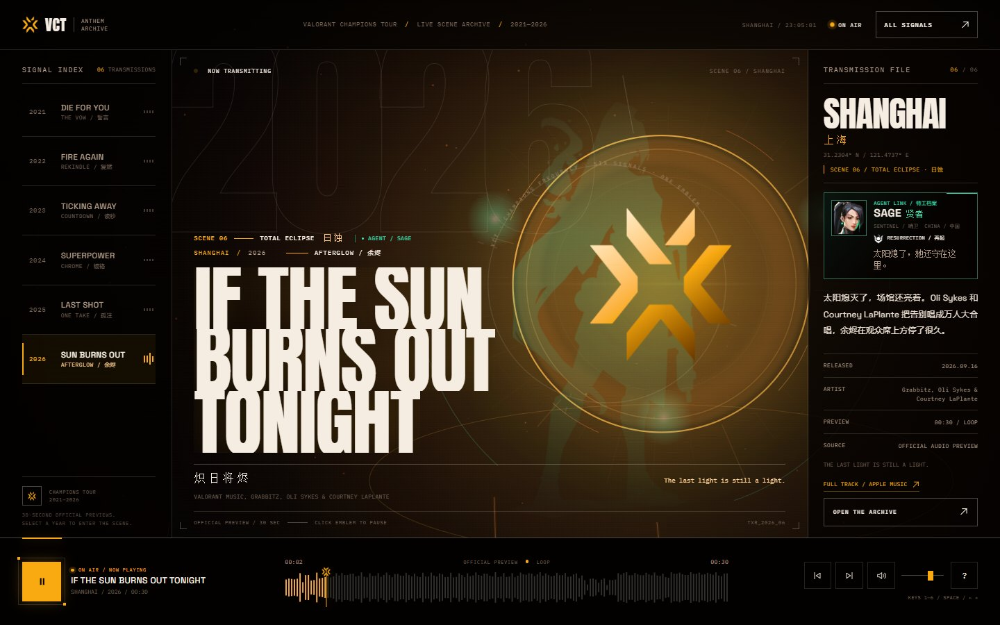
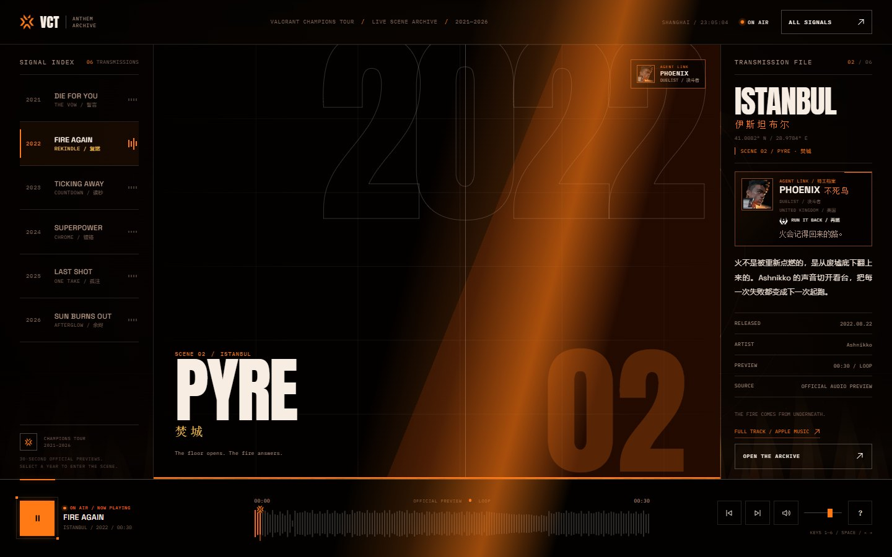
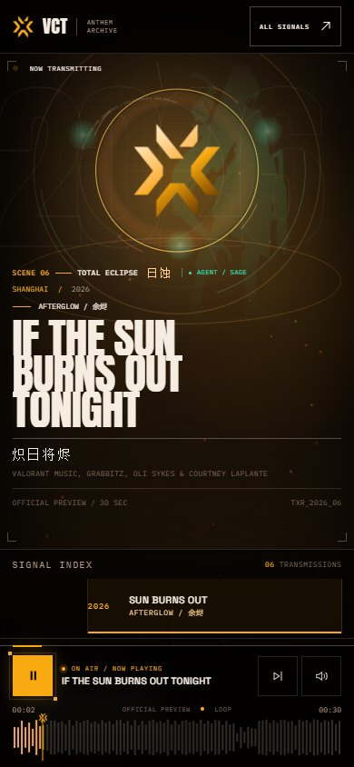

# VCT / THE CHAMPIONS FREQUENCY

> 把 2021—2026 六届 VALORANT 全球冠军赛主题曲，调成同一个频率。
> A fan-made listening instrument built around the official VCT spark.

**在线地址：** <https://opes32.github.io/>  
**源码仓库：** <https://github.com/OPES32/OPES32.github.io>

这不是一个「Hero + 卡片」式的音乐专题页，而是一台被拆开摆在桌面上的 VCT 广播仪器。开场点击接通信号后，2026 上海的主题曲《炽日将烬》立即开始播放；之后每一次换台，都会先切进一块专属的 **SCENE 卡片**，再进入完全不同的现场：颜色、空间、粒子、镜头呼吸、字号节奏和整份曲目档案一起切换。六个现场分别由六位特工把守：REYNA、PHOENIX、KILLJOY、JETT、CHAMBER、SAGE。特工立绘会化为现场的全息剪影，官方头像与终极技能进入右侧「AGENT LINK」档案卡。







---

## 打开 / 运行

需要 Node.js 18+。项目没有 npm 依赖，不需要安装。

```bash
cd vct-frequency
node server.mjs
```

打开 `http://127.0.0.1:4177`。

Windows 也可以直接双击 [`start.bat`](./start.bat)。

> 请通过本地服务器打开。直接双击 `index.html` 时，浏览器会阻止 Web Audio 读取本地音频，页面会给出启动提示。

如果 4177 端口被占用：

```powershell
$env:PORT=4180; node server.mjs
```

---

## 交互

| 操作 | 行为 |
| --- | --- |
| 点击开场按钮 | 启动 BGM，撤离入场幕 |
| 点击左上 VCT 徽记 | 播放 / 暂停 |
| 点击左侧年份 / 底部 ALL SIGNALS | 换台，并同步更换整套视觉系统 |
| 点击或拖动波形 | 在试听片段内定位 |
| `1`—`6` | 直接切换年份 |
| `Space` | 播放 / 暂停（焦点不在按钮上时） |
| `←` / `→` | 后退 / 前进 5 秒 |
| `M` | 静音 |
| `A` | 打开六段信号档案 |
| `Esc` | 关闭档案 / 快捷键浮层 |
| 音量滑杆 | 调整音量 |

移动端保留播放、下一段、静音、波形拖动；年份索引改为横向滑动索引。

---

## 六段信号 / 六个现场

| 年份 | 城市 | 曲目 | 音乐人 | 场景 | 场景构成 |
| --- | --- | --- | --- | --- | --- |
| 2021 | 柏林 | DIE FOR YOU | Grabbitz | **RED CHAPEL / 猩红圣殿** | 红色聚光灯、玻璃碎片、心跳声呐、向舞台收束的圣殿地面 |
| 2022 | 伊斯坦布尔 | FIRE AGAIN | Ashnikko | **PYRE / 焚城** | 中央火柱、底部火墙、上升余烬、跳动的火焰冠 |
| 2023 | 洛杉矶 | TICKING AWAY | Grabbitz & bbno$ | **TIMEBREAK / 断时** | 旋转钟环、巨型时间码、透视时间网格、故障切片 |
| 2024 | 首尔 | SUPERPOWER | KISS OF LIFE & Mark Tuan | **CHROME PRISM / 镜厅** | 棱镜面、镀铬碎片、镜面地板、扫过舞台的激光 |
| 2025 | 巴黎 | LAST SHOT | templuv & 347aidan | **BULLET TIME / 弹时** | 战术网格、持续飞行的曳光、锁定环、HUD 读数 |
| 2026 | 上海 | IF THE SUN BURNS OUT TONIGHT / 炽日将烬 | Grabbitz, Oli Sykes & Courtney LaPlante | **TOTAL ECLIPSE / 日蚀** | 黑日与日冕、旋转耀斑、落灰、熔岩裂缝、全场闪光 |

每场都由 Canvas 2D 实时生成，没有视频、没有预渲染序列。场景会把音频低频、瞬态和镜头呼吸接进同一个运动系统；切台时出现的 **SCENE 卡片** 是每个现场的入场券。

每段音频来自官方 30 秒试听片段，并循环播放。页面上的波形不是装饰图，是从解码后的音频真实计算出的峰值。

## 特工联动

| 年份 | 特工 | 定位 | 终极技能 | 与现场的连接 |
| --- | --- | --- | --- | --- |
| 2021 | REYNA / 蕾娜 | DUELIST / 决斗者 | EMPRESS / 女皇 | 灵魂宝珠漂在猩红圣殿的灯束里，Leer 之眼在暗处睁开 |
| 2022 | PHOENIX / 不死鸟 | DUELIST / 决斗者 | RUN IT BACK / 再燃 | 焚城火柱上展开火鸟的双翼，Phoenix 的全息剪影从火里站起来 |
| 2023 | KILLJOY / 奇乐 | SENTINEL / 哨卫 | LOCKDOWN / 全面封锁 | 钟环变成 Lockdown 的读秒，炮台在舞台边缘扫描 |
| 2024 | JETT / 捷风 | DUELIST / 决斗者 | BLADE STORM / 飓风刃 | 镜厅里有三把回旋的苦无，风痕穿过棱镜 |
| 2025 | CHAMBER / 尚勃勒 | SENTINEL / 哨卫 | TOUR DE FORCE / 力转乾坤 | 金色卡牌悬在准星旁，一条细线直指最后的弹道 |
| 2026 | SAGE / 贤者 | SENTINEL / 哨卫 | RESURRECTION / 再起 | 日蚀旁浮起贤者的玉色宝珠，复活环守着最后一点光 |

特工立绘在舞台上以 **CSS alpha mask** 重新着色，变成与场景同频的全息人影；右侧「AGENT LINK」卡片使用官方头像与终极技能图标。六位特工分别对应六段声音的空间性格，而不是随机贴图。

右侧「TRANSMISSION FILE」底部为每首主题曲保留了 **FULL TRACK / APPLE MUSIC** 入口，可以直接前往官方平台收听完整版。若要把完整版接入站内播放，见下方「换成完整母带」。

---

## 设计 / 创新点

1. **VCT 官方徽记是整台仪器的轴心。**
   作为浏览器里的活体对象，它被切成三块碎片；换台时短暂裂开再合拢，低频驱动它的呼吸，外圈文字环一直缓慢旋转。

2. **六年，不是六次换色，是六个现场。**
   每个年份有自己的空间、材质、运动和叙事：2021 的猩红圣殿、2022 的焚城火柱、2023 的断时钟环、2024 的镜厅棱镜、2025 的弹时曳光、2026 的日蚀塌陷，全部由 Canvas 2D 实时生成，没有视频或第三方动画库。每个现场还挂载一位特工：全息剪影、官方头像、终极技能和专属图形共同构成「英雄元素」，不是六张贴图轮播。

3. **广播控制台，而不是歌单。**
   左栏是年份索引，中央是舞台与巨型曲名，右栏是「传输档案」，底部是真实的波形播放器。版式按大屏、平板、竖屏手机、横屏手机分别重排，而不是把桌面版简单缩小。

4. **换台即换景。**
   先从左侧斜切入一块全舞台 SCENE 卡片，把年份、场景名、城市和一句现场题记压进画面；卡片退场后，新场景已经就位。色板、背景、镜头呼吸、标题入场、档案数据、波形颜色和音频交叉淡入同步发生，不是一次简单换肤。

5. **可被真正使用的播放器。**
   支持进度拖动、键盘控制、音量、静音、暂停保持位置、播放中切台交叉淡入、加载失败重试。波形、时间和 `aria-valuetext` 同步。

6. **克制但有记忆点的系统。**
   无卡片墙、无玻璃拟态、无紫蓝渐变、无假数据。字体只用 Anton / Space Grotesk / IBM Plex Mono，中文标题回到宋体系统字。大量信息使用发丝线、直角和微型标签组织。

7. **六位特工，不是六张贴纸。**
   每位特工都有自己的全息剪影、官方头像、定位、国籍和终极技能。立绘以 alpha mask 融进舞台灯光，技能图形进入 Canvas：Reyna 的灵魂宝珠、Phoenix 的火鸟、Killjoy 的炮台与 Lockdown、Jett 的苦无、Chamber 的金色卡牌、Sage 的玉色宝珠。英雄元素和音频、场景使用同一套切台节奏，不额外加一层装饰。

---

## 音频说明

`assets/audio/` 中是六段 **官方 30 秒试听片段**：

```text
2021-die-for-you.m4a
2022-fire-again.m4a
2023-ticking-away.m4a
2024-superpower.m4a
2025-last-shot.m4a
2026-ashes-of-the-sun.m4a
```

### 换成完整母带

把有授权的完整音轨放到 `assets/audio/`，保持同名文件，或在 [`js/data.js`](./js/data.js) 中修改每首的 `audio` 路径。

页面会从解码后的 buffer 读取真实时长和波形；如果换成完整版，底部总时长和波形会自动适配。页面中「OFFICIAL PREVIEW / 30 SEC」等文案属于试听片段展示，正式上线完整版时请同步调整这些说明。

当前试听片段来自 Apple Music 的公开预览；音频版权归 Riot Games、VALORANT Music 与各音乐人所有。请勿把该文件夹里的音频当作已获授权的商用母带。

---

## 文件结构

```text
vct-frequency/
├─ index.html
├─ server.mjs
├─ start.bat
├─ css/
│  ├─ tokens.css          # 字体、色彩、z-index、动效 token
│  └─ experience.css      # 入场、控制台、档案、响应式
├─ js/
│  ├─ data.js             # 六段信号内容
│  ├─ audio.js            # Web Audio 加载、交叉淡入、波形、分析器
│  ├─ visuals.js          # 六个实时现场：圣殿 / 焚城 / 断时 / 镜厅 / 弹时 / 日蚀
│  └─ app.js              # 状态、播放器 UI、键盘、档案
├─ assets/
│  ├─ audio/              # 官方 30 秒试听
│  ├─ agents/             # 六位特工立绘 / 头像 / 终极技能图标（WebP）
│  ├─ fonts/              # 本地 WOFF2
│  └─ img/                # VCT spark、纹理、OG 图
├─ preview/               # 1440 / 390 / 844 截图
└─ licenses/              # 字体 OFL 授权文本
```

---

## 设计系统

- 方向：**工业粗野 / 广播控制台**
- 三旋钮：`DESIGN_VARIANCE 8.5` / `MOTION_INTENSITY 8.5` / `VISUAL_DENSITY 6`
- 字体：Anton（展示）、Space Grotesk（正文）、IBM Plex Mono（技术标签）、中文宋体（年份主题词）
- 色彩：以深墨为底，每年一个信号色；所有组件颜色引用 CSS 变量
- 动效：只使用 `transform` / `opacity` 做 UI 过渡；背景场由 Canvas 控制；支持 `prefers-reduced-motion`
- 无障碍：跳转链接、可见 focus ring、slider 键盘操作、动态 `aria-live`、`aria-current`、44px 移动端触控目标、可读对比度
- 反 AI 模板自审：`P5 H5 E4 S5 R4 V5`（Philosophy / Hierarchy / Execution / Specificity / Restraint / Variety）

---

## 部署

当前线上版本托管在 **GitHub Pages**：

- 公开仓库：<https://github.com/OPES32/OPES32.github.io>
- 线上地址：<https://opes32.github.io/>
- 发布方式：`main` 分支根目录静态发布，已启用 `.nojekyll`
- 更新方式：提交并推送到 `main`，Pages 会自动重新构建
- 静态站点不依赖 `server.mjs`；这个 Node 文件只用于本地预览

自定义域名可以后续在仓库的 Pages 设置里绑定 `CNAME`，当前使用 GitHub 提供的 `*.github.io` 子路径。

---

## 已验证

在 Chrome 无头浏览器中运行 Playwright 验证，覆盖本地静态服务器与线上 Pages：

- 1440×900、1024×600、390×844、844×390（横屏）无横向溢出；移动端保留纵向滚动，播放器固定在安全区域
- 入场点击后 `AudioContext` 正常启动，播放进度推进，`--bass` 实时变化（非静音占位）
- 六次换台均触发 SCENE 卡片：编号 `01—06`、场景名、城市和年份与当前曲目一致；卡片退场后新场景、新标题和档案同步到位
- 六个 Canvas 现场各自运行：RED CHAPEL 的玻璃与声呐、PYRE 的火柱与余烬、TIMEBREAK 的钟环与故障切片、CHROME PRISM 的棱镜与激光、BULLET TIME 的曳光与准星、TOTAL ECLIPSE 的日冕与熔岩裂缝
- 六次换台的特工联动正确：REYNA / PHOENIX / KILLJOY / JETT / CHAMBER / SAGE 的头像、定位、国籍和终极技能与曲目一一对应；舞台全息剪影、AGENT LINK 卡片和 SCENE 卡片上的特工标签同步切换
- 暂停 / 恢复 / 静音 / 键盘 `1`—`6` / `Space` / `A` 打开档案均通过；暂停时 `--bass` 归零
- 六首音频均成功解码；无页面异常、无失败请求、无重复 `id`
- `prefers-reduced-motion` 下 Canvas 渲染为静态帧；连续两次读取 Canvas 像素完全一致
- 1024×600 的横向压缩档启用了紧凑排版，标题、场景行、题记与播放器均在安全区内

---

## 素材与致谢

- VCT spark 标记：来自 VALORANT 官方赛事素材（[Tencent VALORANT 电竞站的 VCT SPARK 资源](https://esports.val.qq.com/val/VCT_SPARK_RGB_TEAL.png)），在项目里以 CSS mask 重新着色和拆分。VCT、VALORANT、Riot Games 及相关标识归 Riot Games 所有。
- 音乐：Riot Games / VALORANT Music；试听片段来自 Apple Music 公开预览。
- 特工素材：REYNA、PHOENIX、KILLJOY、JETT、CHAMBER、SAGE 的立绘、头像与终极技能图标来自 [valorant-api.com](https://valorant-api.com/)；在项目中经透明裁切、WebP 压缩与 CSS mask 再着色。特工与 VALORANT 相关素材版权归 Riot Games 所有。
- 字体：Anton、Space Grotesk、IBM Plex Mono，SIL Open Font License 1.1；授权文本见 [`licenses/`](./licenses/)。
- 本项目是独立粉丝概念，与 Riot Games 无隶属或背书关系。

---

## 已知限制

- 当前内置音轨均为 30 秒官方预览；完整曲目需要替换为有授权的母带。
- 音频循环是片段级循环，不负责做母带级无缝拼接。
- 浏览器实机验证以 Chromium 为主；Safari / iOS 的 Web Audio 行为未做实体设备验证。
- 没有后端；所有状态都是本地现场状态，刷新后回到 2026 上海。
